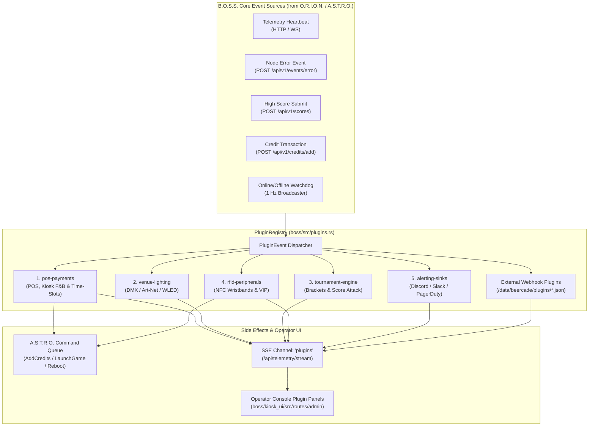

# B.O.S.S. — Beercade Operational Supervisory System
## Final System Specification, Public Kiosk UI, Admin Portal & Plugin Architecture (v1.0)

---

## 1. System Identity & Architectural Definitions

Within the **B.E.E.R.C.A.D.E.** (*Beercade Entertainment & Emulation Resource: Centralized Arcade Delivery Ecosystem*) repository, each subsystem adheres to strict architectural boundaries:

- **B.E.E.R.C.A.D.E.** (*Beercade Entertainment & Emulation Resource: Centralized Arcade Delivery Ecosystem*): The overarching umbrella project and ecosystem.
- **B.O.S.S.** (*Beercade Operational Supervisory System*): Arch Linux-based control core and operational supervisor.
  - **Hosts**:
    1. **Touchscreen-Friendly Public Kiosk UI (`/`)**: Time-slot station bookings, token balance/management, arcade station access & game launch, and food/beverage ordering.
    2. **Admin / Venue Web Management Portal (`/admin`)**: Dual-mode operator supervisory console (LAN Bearer auth + physical kiosk 6-digit PIN unlock) and Hybrid Plugin Hub.
  - **Deployment Target**: Raspberry Pi 4 / Raspberry Pi 5, portable to Radxa Rock 5C (generic Arch Linux SBC profile, with no mandatory RK3588 hardware dependency).
- **O.R.I.O.N.** (*Optimized Rockchip Interface & Operations Node*): Bare-board, headless RK3588 / RK3588S2 client compute nodes (Radxa ROCK 5C 32GB / Orange Pi 5 Pro 16GB LPDDR5) with active PWM thermal curves.
- **A.S.T.R.O.** (*Arcade System & Tuned Retro OS*): Custom Arch Linux runtime executed on **O.R.I.O.N.** hardware. Boots direct-to-KMS/DRM (zero X11/Wayland overhead), running a low-latency, hardware-accelerated emulation engine communicating directly with **B.O.S.S.**
- **`website/`**: External customer-facing web portal and marketing interface (SvelteKit on Cloudflare Pages + D1 + KV + Stripe).
- **`shared/`**: Common libraries (`beercade-shared`, `beercade-hal`), IPC contracts, sync agents, build recipes, and unified Arch baseline tooling shared between **B.O.S.S.** and **A.S.T.R.O.**

---

## 2. B.O.S.S. Hardware & Runtime Specification

| Parameter | Primary B.O.S.S. Appliance Target | Portable B.O.S.S. SBC Target | O.R.I.O.N. Client Nodes (Managed Fleet) |
| :--- | :--- | :--- | :--- |
| **Hardware Platform** | Raspberry Pi 4 / Raspberry Pi 5 (BCM2711 / BCM2712) | Radxa ROCK 5C (Generic Arch ARM64 SBC profile) | Radxa ROCK 5C 32GB / Orange Pi 5 Pro 16GB LPDDR5 |
| **SoC / Acceleration** | Generic ARM64 (no RK3588 dependency) | Generic ARM64 Arch baseline | RK3588 / RK3588S2 + Active PWM Thermal Curves |
| **OS Runtime** | Arch Linux (`boss-server.service` + `boss-kiosk.service`) | Arch Linux | **A.S.T.R.O.** (Arch Linux direct-to-KMS/DRM, zero X11/Wayland) |
| **Storage Layout** | SD / NVMe (`/data/beercade` partition) | eMMC / NVMe (`/data/beercade`) | SquashFS A/B RootFS + `/data` overlay |
| **HTTP / WS / SSE Port** | `0.0.0.0:8989/tcp` (`BOSS_PORT`) | `0.0.0.0:8989/tcp` | Polls/Streams to `BOSS_HOST:8989` |
| **Netplay Relay Port** | `0.0.0.0:9750/udp` (`BOSS_NETPLAY_UDP_PORT`) | `0.0.0.0:9750/udp` | P2P Rollback (`OR` wire protocol) |

### Environment Configuration Variables

| Variable | Default | Purpose |
| :--- | :--- | :--- |
| `BOSS_HOST` | `0.0.0.0` | Bind address for the HTTP/WS/SSE server |
| `BOSS_PORT` | `8989` | TCP port for REST API, SSE hub, and static Kiosk UI |
| `BOSS_NETPLAY_UDP_PORT` | `9750` | UDP port for A.S.T.R.O. netplay discovery and relay |
| `BOSS_VENUE_NAME` | `Beercade Redfern (The BK)` | Human-readable venue identifier |
| `BOSS_VENUE_ADDRESS` | `113-115 Regent St, Redfern NSW 2016` | Physical venue address |
| `BOSS_RPC_TOKEN` | *(ephemeral UUIDv4 if unset)* | Master operator Bearer token for RPC & LAN `/admin` |
| `BOSS_NODE_TOKEN` | *(falls back to `BOSS_RPC_TOKEN`)* | O.R.I.O.N. node ingest Bearer token for A.S.T.R.O. heartbeats |
| `BOSS_OPERATOR_PIN` | `898900` | 6-digit physical kiosk operator PIN for touch unlock |
| `BOSS_STATIC_DIR` | `./kiosk_ui/build` | Compiled SvelteKit static bundle path |
| `BOSS_SYNC_DIR` | `/data/beercade/sync` | Directory for staged A.S.T.R.O. SquashFS OTA payloads |
| `BOSS_PLUGINS_DIR` | `/data/beercade/plugins` | Directory for external JSON plugin manifests |
| `BOSS_UI_THEME` | `taproom` | Starting venue UI theme if none is saved (`taproom`, `vector`, `bigsky`, `pinball`, `classic`) |
| `BOSS_UI_THEME_FILE` | `/data/beercade/state/ui_theme` | Where the operator's theme choice is persisted |
| `BOSS_UI_EFFECTS` | `lite` on ARM, `full` on x86_64 | `lite` turns off blur, glows and fixed backgrounds on every screen (for Raspberry Pi GPUs) |
| `EDGE_INGEST_URL` | *(disabled if unset)* | Cloudflare Worker `/api/v1/edge/ingest` endpoint |
| `EDGE_INGEST_TOKEN` | *(empty)* | Shared Bearer secret for Cloudflare D1 edge ingest |

---

## 3. Public Kiosk UI & Dual-Mode Operator Console (`boss/kiosk_ui`)

`boss/kiosk_ui` is a touchscreen-first SvelteKit static bundle served directly by `boss-server` on `:8989`.

### 3.1 Public Patron Touchscreen Kiosk (`/`)
Provides four dedicated touchscreen workflows for venue patrons:
1. **Arcade Station Access (`stations`)**: Live status of all **O.R.I.O.N.** client compute nodes running **A.S.T.R.O.** (`Managed` time-slot countdowns, `Standalone` credit counters, active ROM/core, 1000Hz `evdev` input latency, P2P rollback link status) plus 1-tap game selection.
2. **Token Balance & Top-Up (`tokens`)**: Express QR code checkout (`pos-payments`) and NFC wristband / VIP card balance lookup & tap-to-credit (`rfid-peripherals`).
3. **Time-Slot Station Bookings (`bookings`)**: On-premise time-slot reservations (30 / 60 / 120 minutes) for specific **O.R.I.O.N.** stations or group booths, transitioning stations into `StationMode::Managed { session_id, time_remaining_sec }`.
4. **Food & Beverage Ordering (`menu`)**: Touchscreen ordering for Signature Cocktails, Craft Taps, Woodfired Pizzas, and Arcade Bites delivered directly to an **O.R.I.O.N.** arcade station or booth table via the POS plugin.

### 3.2 Dual-Mode Operator Access (`/admin`)

```mermaid
flowchart LR
    subgraph PhysicalKiosk["B.O.S.S. Touchscreen Kiosk (/)"]
        PatronTabs["Patron UI: Stations · Tokens · Time-Slots · Food/Drinks"]
        SecretGesture["5-Tap Top-Right Corner Gesture\n(or Ctrl+Shift+O)"]
        PinModal["6-Digit Touch PIN Keypad\n(POST /api/v1/auth/pin)"]
        PatronTabs --> SecretGesture --> PinModal
    end

    subgraph LanAccess["Venue LAN Tablet / Desktop (/admin)"]
        DirectAdmin["Direct /admin Navigation"]
        TokenOrPin["Bearer BOSS_RPC_TOKEN\nor 6-Digit Operator PIN"]
        DirectAdmin --> TokenOrPin
    end

    PinModal -->|Session Token\n(15m TTL + 5m Idle Lock)| AdminConsole["B.O.S.S. Operator Portal (/admin)"]
    TokenOrPin -->|Constant-Time Verified| AdminConsole
```

---

## 4. Hybrid Plugin System Architecture

The B.O.S.S. Plugin System combines **in-tree compiled Rust plugins** (`BossPlugin` async trait) with **declarative JSON manifests & webhook subscribers** (`PluginManifest`), unified under a single event bus and exposed to `boss/kiosk_ui` through structured UI panel descriptors.



---

## 5. First-Party Plugin Categories & Plugin SDK

1. **`pos-payments` — Square POS, Online A.S.T.R.O. Game-Time Passes, Time-Slots & Kiosk F&B Ordering**:
   - Integrates **Square Terminal API**, **Square Online Checkout Payment Links**, Stripe WisePOS E, and Nayax VPOS Touch.
   - Ties online purchases of **A.S.T.R.O. Timed Game-Time Passes** (`30-Min`, `60-Min`, `2-Hour` passes purchased on `website/src/routes/tokens`) directly to O.R.I.O.N. cabinets via `activate_game_time_pass`, dispatching initial credits and tracking active countdown sessions (`active_timed_sessions`) on B.O.S.S.
   - Also supports kiosk time-slot reservations (`book_timeslot`) and Square KDS Food & Beverage orders (`submit_fb_order`).
2. **`venue-lighting` — Multi-Zone / Multi-System Venue Lighting (WLED / Art-Net DMX512 / sACN E1.31 / Philips Hue)**:
   - Orchestrates multiple lighting systems simultaneously across independent venue zones (`arcade_floor`, `tournament_stage`, `taproom_bar`, `cabinet_marquees`).
   - Supports global scene overrides (`set_scene`), per-zone scene overrides (`set_zone_scene`), multi-protocol fixture registration (`add_fixture`), and reactive event cues (`HighScore`, `CreditTransaction`, `NodeOffline`, `ErrorReported`).
3. **`tournament-engine` — Tournament, High-Score Leaderboard & On-Site TV Attractor Signage (`/tv`)**:
   - Manages single-elimination brackets, live score-attack leaderboards, and on-site **Venue TV Attractor & High Score Signage Streams** (`/tv?zone=main`, `/tv?zone=bar`, `/tv?zone=stage`).
   - Streams at 60fps over LAN Smart-TV browsers or via the Raspberry Pi 4/5 secondary `HDMI-1` port, with real-time SSE **High Score / Match Winner Fanfare Interrupts** (`trigger_tv_fanfare`).
4. **`rfid-peripherals` — RFID / NFC Wristband & Card Peripherals**:
   - Manages patron NFC wristbands and VIP free-play cards (`tap_card`, `register_card`, `topup_card`, `toggle_vip`), dispatching instant `AddCredits` commands to the tapped O.R.I.O.N. node.
5. **`alerting-sinks` — Alerting & Ops Sinks**:
   - Monitors O.R.I.O.N. RK3588/RK3588S2 CPU/GPU temperatures against configurable PWM thermal warning thresholds (`78.0 °C` default) and routes alerts to Discord, Slack, PagerDuty, and Telegram webhooks.

---

## 6. B.O.S.S. Plugin SDK (`boss/plugin_sdk/`)
- **Manifest Schema**: [`boss/plugin_sdk/boss-plugin.schema.json`](./plugin_sdk/boss-plugin.schema.json)
- **TypeScript Definitions**: [`boss/plugin_sdk/index.d.ts`](./plugin_sdk/index.d.ts)
- **Developer Guide & Reference Plugin**: [`boss/plugin_sdk/README.md`](./plugin_sdk/README.md) & [`boss/plugin_sdk/examples/custom-marquee-plugin/`](./plugin_sdk/examples/custom-marquee-plugin/manifest.json)
