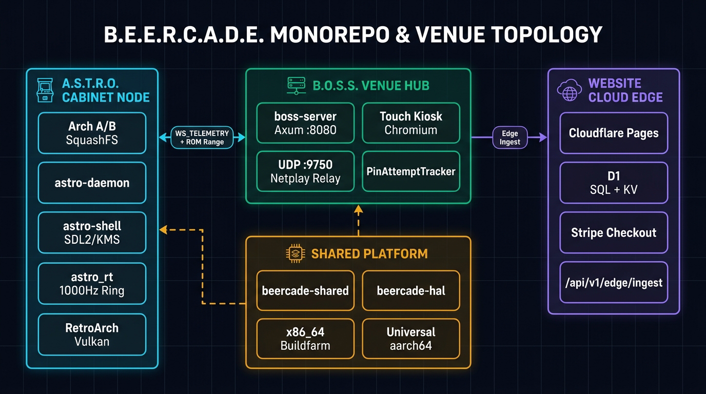
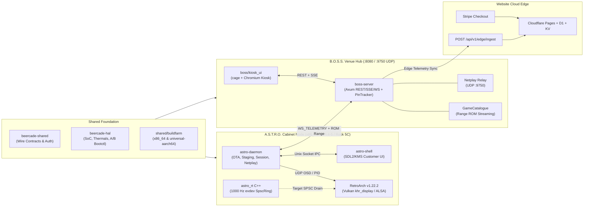
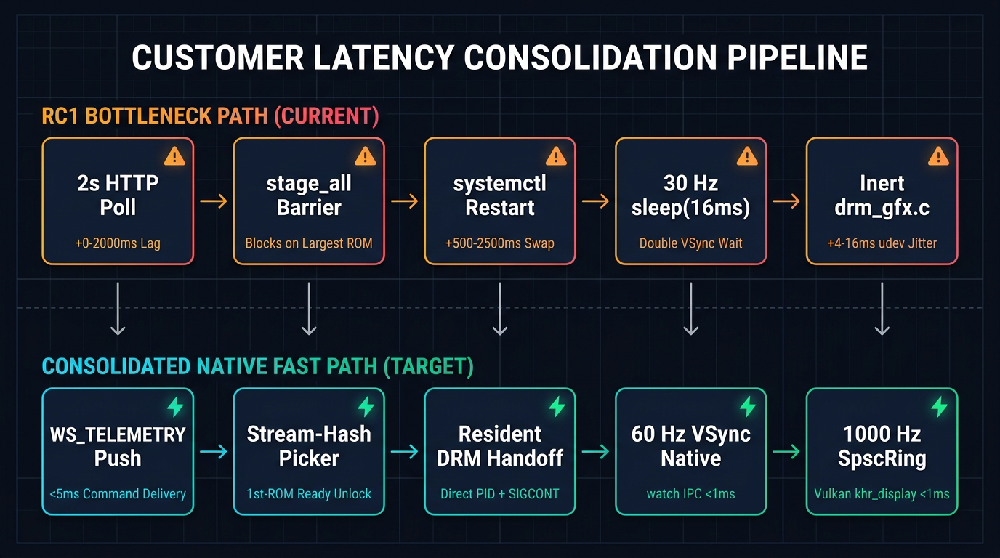
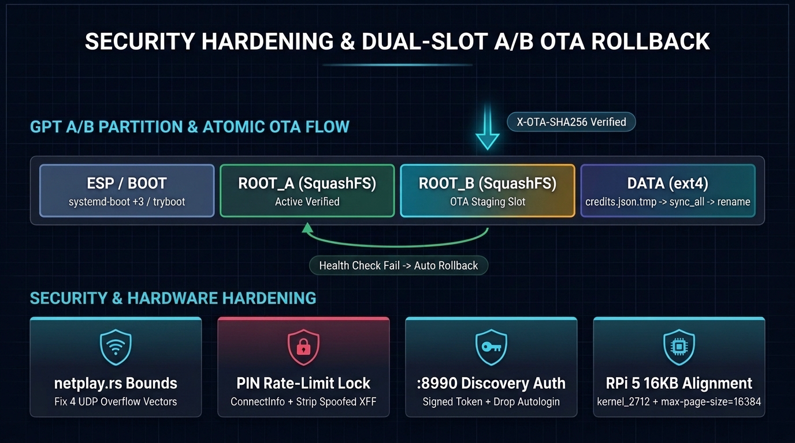
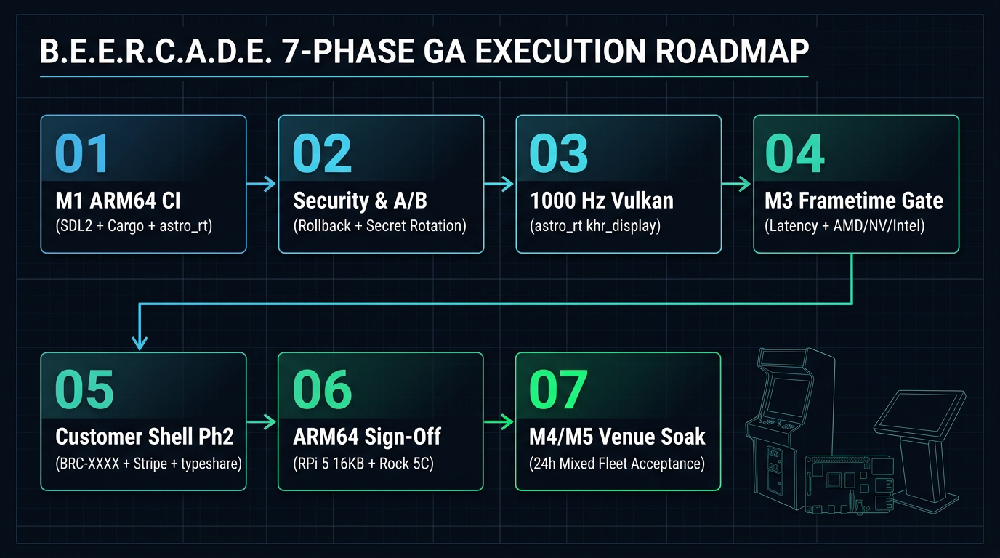
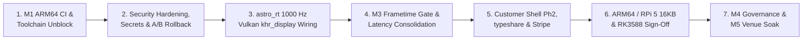

# B.E.E.R.C.A.D.E. RC1 Audit, Storage Hygiene & GA Completion Roadmap

**Date:** 2026-11-19  
**Repository:** `d:\data\dev\beercade` · Branch: `main` · Remote: `git.3hx.au/outl4w/beercade`  
**Verified Baseline Commit (local `main`, unpushed):** `5757f34727a22566111949f47f93bfc3e7b0a2f9` (`5757f34`)  
**Scope:** Phase-1/RC1 working-tree verification & commit, source-only Graphify extraction, discretionary stale-artifact purge, full-repo latency consolidation audit, security/panic/16 KB page-size audit, and 7-phase GA execution roadmap.

---

## Executive Summary

| Dimension | Outcome / Key Metric | Details |
| :--- | :--- | :--- |
| **RC1 Baseline Commit** | `5757f34` (47 files, +4,718 / -1,186 lines) | Enforces `X-OTA-SHA256`, atomic credits, `PinAttemptTracker`, LAN discovery, seeded `GameCatalogue`, universal `aarch64` buildfarm, `.graphifyignore`, and `AGENTS.md`. |
| **Workspace Verification** | **141/141** non-SDL Rust tests pass; **0** web errors | `cargo check --workspace` exits `0`; `boss/kiosk_ui` & `website` `svelte-check` exit `0`. `astro-shell` tests require Linux `SDL2.lib`. |
| **Graphify Cleanup** | **245.3 MB -> 2.22 MB** (`-99.1%`) | Rebuilt with `.graphifyignore`: **2,037 nodes · 3,941 edges · 148 communities** (down from 146,257 polluted nodes). |
| **Discretionary Purge** | **46,631,045,810 B (43.43 GiB)** reclaimed | Purged stale images in `out/`, `.ai-ignore/archive/`, and `astro/rootfs/` cross-builds while keeping all `u-boot*`, `*.mp4`, `universal-aarch64/boot/Image`, and `lib/{modules,firmware}`. |
| **Top Latency Targets** | **#1–#10** ranked native consolidations | Replaces 2 s HTTP command polling (`WS_TELEMETRY`), `stage_all` ROM barrier (per-ROM `Picker`), `systemctl` launcher stalls (resident DRM handoff), `sleep(16ms)` 30 Hz shell cap, and inert `drm_gfx.c` drain (`1000 Hz` Vulkan `khr_display`). |
| **Security & Reliability Blockers** | **4** UDP panic/DoS vectors; **PIN XFF bypass**; **Slot B unbootable** | `netplay.rs` overflow/OOM bounds, missing `ConnectInfo` + spoofed XFF on PIN unlock, unauthenticated `:8990` discovery takeover, hardcoded dev tokens (`beercade-dev-token` / `"898900"`), and missing A/B rollback + 16 KB `kernel_2712.img` packaging. |

*Figure 1 — B.E.E.R.C.A.D.E. end-to-end topology spanning A.S.T.R.O. cabinet nodes, the B.O.S.S. venue server & touchscreen kiosk, shared Rust HAL/buildfarm infrastructure, and the Cloudflare Pages/D1/Stripe web edge.*

---

## 1. RC1/Phase-1 Verification & Commit Record

### 1.1 Commit Summary
- **Commit:** [`5757f34727a22566111949f47f93bfc3e7b0a2f9`](../../) on local `main` (not pushed).
- **Message:** `rc1: enforce OTA SHA-256, PIN rate-limiting, LAN discovery, game catalogue, and universal aarch64 buildfarm`
- **Diff Stat:** `47 files changed, 4718 insertions(+), 1186 deletions(-)`

### 1.2 Toolchain & Test Verification Matrix
| Workspace / Target | Command | Result | Exact Observation |
| :--- | :--- | :--- | :--- |
| Full Rust Workspace (6 crates) | `cargo check --workspace --message-format=short` | **PASS** (exit `0`) | 0 errors across all 6 crates (`beercade-shared`, `beercade-hal`, `astro-daemon`, `astro-shell`, `astro-tune`, `boss-server`). 31 Windows-only unused-code/import warnings in `astro/daemon/src/{input,shell_ipc}.rs`; 0 warnings in the remaining 5 crates. |
| `beercade-shared` | `cargo test -p beercade-shared --quiet` | **PASS** (`16 passed, 0 failed`) | Auth, crypto, shared telemetry/session contract tests pass. |
| `beercade-hal` | `cargo test -p beercade-hal --quiet` | **PASS** (`9 passed, 0 failed`) | Arch/SoC detection and platform capability tests pass. |
| `astro-daemon` | `cargo test -p astro-daemon --quiet` | **PASS** (`66 passed, 0 failed`) | Includes 11 new `ota.rs` SHA-256 rejection tests, atomic credit persistence & corruption recovery, command ACK, and R3 static-IP checks. |
| `astro-tune` | `cargo test -p astro-tune --quiet` | **PASS** (`5 passed, 0 failed`) | Governor/CPU tuning unit tests pass. |
| `boss-server` | `cargo test -p boss-server --quiet` | **PASS** (`45 passed, 0 failed`) | Includes `PinAttemptTracker`, `GameCatalogue`, auth, routes, and netplay relay tests. |
| `astro-shell` | `cargo check -p astro-shell` / `cargo test -p astro-shell --quiet` | **CHECK PASS / LINK BLOCKED** (exit `101`) | Compiles cleanly under `cargo check`, but Windows MSVC linking fails at `LNK1181: cannot open input file 'SDL2.lib'` for the 5 tests in `astro/shell/src/ui.rs:125-185`. WSL `Ubuntu-24.04` lacks a Rust toolchain and Docker Desktop daemon is stopped; must run on Linux CI/runner with `libsdl2-dev` + `libsdl2-ttf-dev`. |
| `boss/kiosk_ui` | `npm --prefix boss/kiosk_ui run check` | **PASS** (exit `0`) | `svelte-check`: `0 errors and 0 warnings`. |
| `website` | `npm --prefix website run check` | **PASS** (exit `0`) | `wrangler types --check` up to date; `svelte-check`: `0 errors and 0 warnings`. |

### 1.3 Mandatory RC1 Invariant Audit
| Invariant | Status | Implementation Evidence (`file:line`) | Audit Notes |
| :--- | :---: | :--- | :--- |
| **Mandatory `X-OTA-SHA256` verification & staging cleanup** | **PASS** | `astro/daemon/src/ota.rs:45-64`, `86-142` | Rejects missing, empty, or non-UTF-8 `X-OTA-SHA256` headers and deletes `staging_path`. Streams download chunks, calls `dest.sync_all()` (`:112`), verifies non-zero size & `Content-Length` (`:122-132`), checks `constant_time_eq` SHA-256 (`:135-142`), and deletes `staging_path` on every failure. Minor gap: `execute_ota_update` (`:164-168`) does not unlink `staging_path` if `dd` or `commit_boot_slot` fails post-staging. |
| **Atomic credit persistence + `.bak` tiered recovery** | **PASS** | `astro/daemon/src/main.rs:57-102`, `110-193` | Writes `credits.json.tmp`, calls `file.sync_all()?` (`:90`), drops file handle (`:92`), calls `std::fs::rename(&tmp, path)?` (`:96`), and copies to `credits.json.bak` (`:99`). On boot, `load_credits` recovers primary -> `.bak` with primary self-heal (`:164`) -> zero default (`:192`). Minor note: `.bak` write at `:99` uses `fs::copy` instead of tmp+sync+rename. |
| **PIN rate limiting (5 failures / 60 s lockout)** | **GAP** | `boss/src/state.rs:145-269`, `boss/src/routes.rs:158-273`, `boss/src/main.rs:171` | `PinAttemptTracker` (`PIN_MAX_ATTEMPTS=5`, `PIN_LOCKOUT_SECS=60`) and `verify_operator_pin` (`429` + `Retry-After: 60`) pass unit tests, **but** `boss/src/main.rs:171` uses `axum::serve(listener, app)` without `.into_make_service_with_connect_info::<SocketAddr>()` AND `extract_client_ip` (`routes.rs:162-185`) unconditionally trusts `CF-Connecting-IP`, `X-Forwarded-For`, and `X-Real-IP`. Direct clients collapse to `"127.0.0.1"`, and any LAN attacker can rotate `X-Forwarded-For` to bypass lockout completely. |

### 1.4 Committed Scope vs. Deliberate Exclusions & Working-Tree Caveats
- **Committed (`5757f34`):**
  - Core Rust/TS/Systemd changes: `Cargo.lock`, `AGENTS.md`, `.graphifyignore`, `astro/daemon/Cargo.toml`, `astro/daemon/src/{main,ota,discovery}.rs`, `astro/shell/src/{main,ui}.rs`, `astro/platform/aarch64/**`, `boss/Cargo.toml`, `boss/src/{main,routes,state,catalogue,discovery}.rs`, `boss/kiosk_ui/src/lib/bossApi.ts`, `boss/kiosk_ui/src/routes/admin/+page.svelte`, `boss/platform/common/rootfs/usr/lib/{systemd/system/boss-*.service,tmpfiles.d/boss.conf}`.
  - Buildfarm & Universal AArch64 boot configs/DTBs: `shared/buildfarm/{aarch64,x86_64}/{build_image.sh,container_build.sh,payloads/*.conf}`, `shared/platform/universal-aarch64/boot/{cmdline.txt,config.txt,extlinux/extlinux.conf,*.dtb,overlays/*.dtbo}`.
  - Removed 6 superseded root markdown files (`ARCHITECTURE_REVIEW_{FEATURES,FINAL}.md`, `DIAGNOSIS_REPORT_RPi5_BOOT.md`, `REMEDIATION_PLAN.md`, `TEST_INFRA.md`, `x86_64_fork_and_patch_sync_plan.md`) that were moved under `completed_prompts/`.
- **Excluded from Commit (preserved untouched on disk):**
  - *CRLF-only noise reverted via `git checkout --`:* `astro/launcher/astro_kms_launcher.sh`, `boss/kiosk_ui/package-lock.json`.
  - *Security exclusions:* `boss/platform/common/rootfs/usr/lib/systemd/system/getty@tty2.service.d/autologin.conf` and `serial-getty@ttyS0.service.d/autologin.conf` (passwordless `--autologin root`).
  - *Large binaries & generated artifacts:* `shared/platform/universal-aarch64/boot/Image` (`16,083,456 B`), `shared/buildfarm/aarch64/bootloader/u-boot-rockchip.bin` (`9,638,912 B`), `ASTRO_rc1.mp4` (`102,711,987 B`), `graphify-out/`.
  - *Scratch & local docs:* `.agents/teamwork/**`, `completed_prompts/**` (contains unrelated Omnius/Kasm files alongside archived reviews), `astro/daemon/tests/empirical_challenge_m3_2.py`, `boss/tests/empirical_challenge_m2.py` (hardcode Windows `.exe` paths), `ORIGINAL_REQUEST.md`, `CLAUDE.md`, `beercade_project_completion_handover.md`.
- **Working-Tree Caveats Logged in `5757f34`:**
  1. `astro/daemon/src/main.rs:1051` defaults `BOSS_ENDPOINT` to `http://boss:8989`, whereas `boss-server.service:12` binds `BOSS_PORT=8080`.
  2. `astro/daemon/src/discovery.rs:79-124,193-240` lets any LAN host overwrite `boss_url` and `boss_token` via unauthenticated `:8990` HTTP/UDP without verifying token authority.
  3. `boss/src/discovery.rs:225-235` registers synthetic `cpu_temp_c: Some(42.0)` / `gpu_temp_c: Some(40.0)` before the first real node heartbeat arrives.
  4. `shared/buildfarm/aarch64/build_image.sh:34-74` reuses pre-existing binaries/frontends in `out/bin-*-aarch64` / `out/fe-*-aarch64`, risking stale image contents after edits.
  5. `boss/platform/common/rootfs/usr/lib/tmpfiles.d/boss.conf:9` sets `/data/beercade/logs` mode `0777 root root` (world-writable log directory).
  6. `shared/platform/universal-aarch64/boot/config.txt:13,17` boots `kernel=kernel8.img` (Arch's 4 KB kernel) while `universal-aarch64/boot/Image` sits beside it.

---

## 2. Graphify & Memory Sync Delta

### 2.1 Graphify Before-vs-After Extraction
| Metric | Archived Graph (`2026-10-01`, purged) | Clean Graph (`2026-11-19` @ `5757f34`) | Delta |
| :--- | :--- | :--- | :--- |
| Location | `.ai-ignore/archive/graphify-out/` | `graphify-out/` (git-untracked) | Replaced via `.graphifyignore` |
| `graph.json` size | `245,306,297 B` (~233.9 MiB) | `2,215,280 B` (~2.11 MiB) | **-99.10%** |
| Total directory size | `6,568,447,552 B` (171,826 files) | ~2.36 MiB (`graph.json`, `GRAPH_REPORT.md`, `manifest.json`, `.graphify_analysis.json`) | **-99.96%** |
| Corpus scanned | 7,978 files (polluted by `node_modules`, `.d.ts`, shaders) | 154 source files + Cargo workspace (6 crates, 5 edges) | Source-only |
| Nodes / Edges / Communities | **146,257** / **376,224** / **3,398** | **2,037** / **3,941** / **148** | **-98.6%** nodes |

*Parser coverage note:* `graphify extract . --code-only --cargo --force` reported partial AST extraction warnings on 18 Svelte/C-header files (`astro/rt/include/astro_rt/input_events.h:117` and Svelte `<script>` blocks) plus 2 `.sql` migration files skipped due to missing `tree_sitter_sql`.

### 2.2 Top 15 Architectural God-Nodes & Live Query Findings
| Rank | Symbol | Connections | Subsystem |
| :---: | :--- | :---: | :--- |
| 1 | `AppState` | 45 edges | `boss/src/state.rs` |
| 2 | `GameRef` | 34 edges | `beercade-shared` |
| 3 | `DaemonSharedState` | 31 edges | `astro/daemon/src/main.rs` |
| 4 | `test_app()` | 27 edges | `boss/src/routes.rs` (tests) |
| 5 | `execute_cabinet_command()` | 23 edges | `astro/daemon/src/main.rs` |
| 6 | `getApiBase()` | 22 edges | `boss/kiosk_ui` |
| 7 | `RequireRpcToken` | 21 edges | `boss/src/routes.rs` |
| 8 | `Session` | 21 edges | `astro/daemon/src/session.rs` |
| 9–10 | `RollbackSession` / `RollbackSession<C>` | 20 edges each | `astro/daemon/src/netplay.rs` |
| 11 | `SpscRing` | 19 edges | `astro/rt/include/astro_rt/spsc_ring.hpp` |
| 12 | `main()` | 19 edges | Binary entrypoints |
| 13 | `stage_ota_payload()` | 19 edges | `astro/daemon/src/ota.rs` |
| 14 | `BossPlugin` | 18 edges | `boss/src/plugins.rs` |
| 15 | `launch_game()` | 18 edges | `astro/daemon/src/main.rs` |

- `graphify query "PinAttemptTracker"`: cleanly maps `boss/src/state.rs:170` -> `AppState:290`, `PinAttemptRecord:163`, `.check_lockout()`, `.record_failure_at()`, `.clean_expired()`.
- `graphify query "astro_input_drain"`: confirms `astro_input_drain()` (`astro/rt/src/input_evdev.cpp:241`) and `SpscRing::drain()` (`spsc_ring.hpp:92`) are isolated in Community 17/30 with **zero call edges** from `astro-daemon`, `astro-shell`, or active launcher code.
- `graphify query "NodeTelemetry"`: confirms `sample_telemetry()` (`astro/daemon/src/main.rs:268`) calls `sample_input_jitter()` (`:221`, stub returning `0.0`), with zero TypeScript structural edges (confirming manual TS schema drift).

### 2.3 OpenViking, `CLAUDE.md` -> `GEMINI.md` & Docs-vs-HEAD Drift
- **OpenViking MCP (`https://viking.3hx.au/mcp`):** Offline/unconfigured in this Antigravity runtime (only `.claude/settings.local.json` references `mcp__openviking__tree`/`write`); audit proceeded using local repository context per `AGENTS.md`.
- **`CLAUDE.md` -> `GEMINI.md` Status:** `GEMINI.md` was never created. Its role was consolidated into tracked [AGENTS.md](file:///d:/data/dev/beercade/AGENTS.md) (27 lines covering OpenViking, Cargo workspace crate boundaries, and verification commands), while untracked [CLAUDE.md](file:///d:/data/dev/beercade/CLAUDE.md) (10 lines) remains as a stale subset.
- **Docs vs. `HEAD` Drift:**
  - `docs/ROADMAP_x86_64.md:50-52`: lists optional thermals as undecided, though `Option<f32>` already landed (`c6cea4c`). Lines `:135-193` still anchor M3 around ES-DE despite `astro-shell` replacing ES-DE.
  - `docs/OPTIMIZATION_BACKLOG.md:61-76`: marks B1–B10 complete, whereas ARM64 B.O.S.S. has not booted physical RPi hardware and Slot B remains unbootable.
  - `docs/ASTRO_CUSTOMER_SHELL_PLAN.md`: Phase 1 shipped on `astro-daemon`/`astro-shell`, while `boss/src/{plugins,routes}.rs` and `boss/kiosk_ui` do not yet populate `session_code`, `games`, or `state.set_node_session()`.

---

## 3. Hygiene, Storage Cleanup & Customer-Latency Consolidation Plan

### 3.1 Tracked Dead Files, Obsolete Scripts & Conflicting Configs
| Category | Tracked Path(s) | Proof of Obsolescence / Conflict | Purge Verdict |
| :--- | :--- | :--- | :---: |
| **ES-DE Remnants** | `astro/emulators/frontend/{boot_esde.sh,es_systems.cfg,beercade_neon_theme/theme.xml}`, `astro/emulators/frontend/es-de/build_x86_64.sh`, `astro/rootfs/etc/emulationstation/es_systems.cfg`, `astro/platform/x86_64/rootfs/etc/emulationstation/es_systems.cfg`, `astro/rootfs/root/ES-DE/*` (4 files), `astro/rootfs/root/ROMs` | 0 active callers (`astro-shell` replaced ES-DE); `astro/rootfs/etc` and `root/ES-DE` still get overlaid into images via `aarch64/payloads/astro.conf`. `ROMs` is a broken symlink stub. | **YES** |
| **Obsolete Helper Scripts** | `astro/platform/rk3588/{mali_mpp_rga.sh,pwm_fan.sh,rk3588_optimizer.sh}`, `astro/emulators/shaders/shader_precompile.sh` | 0 callers (`rk3588_optimizer.sh` referenced only by dead ES-DE configs and legacy rootfs script); superseded by `astro-tune`. | **YES** |
| **Legacy Buildfarm & Initcpio** | `astro/initcpio/*` (3), `astro/scripts/*` (4), `shared/buildfarm/{Dockerfile.buildfarm,setup_buildfarm_env.sh,scripts/*.sh}` (15), `shared/arch/provisioning/*` (2) | Superseded by `shared/buildfarm/{x86_64,aarch64}/build_image.sh` + `astro_overlay`. Note legacy `scripts/build_retroarch.sh` clones unpinned `master` without `astro_rt`. | **YES** |
| **Broken VM Scripts** | `boss/emulate_boss.ps1`, `boss/emulate_boss.sh` | Hardcode missing `BOSS/` and `ASTRO/` paths; superseded by `shared/tests/verify_qemu_*.{sh,py}`. | **YES** |
| **Symlink Stubs & Duplicate Net/Udev** | `astro/rootfs/etc/systemd/system/multi-user.target.wants/*` (4), `boss-static-net.service`, `astro/platform/rk3588/udev/99-beercade-gamepad.rules`, `shared/arch/systemd/{mdns.conf,10-wired.network}` | `.wants` stubs are excluded during build (`--exclude='*.wants'`); udev & mdns duplicate active overlays. | **YES** |
| **Coupled Legacy Net Script** | `astro/rootfs/usr/local/bin/boss_static_net.sh` | Service unit is disabled, **but asserted by unit test** at `astro/daemon/src/main.rs:2085-2094`. | **NO** (remove test first) |
| **3-Way RK3588 RetroArch Conflict** | `astro/rt/deploy/retroarch_rk3588.cfg`, `astro/rootfs/root/.config/retroarch/retroarch.cfg` (identical SHA-256 `18655E5E...`) vs `astro/emulators/configs/retroarch_rk3588.cfg`; `astro/rootfs/etc/retroarch.cfg` | `astro/rootfs/root/.config/retroarch/retroarch.cfg` is overlaid on universal `aarch64` and sets **`audio_driver="null"`**, `gl`, `kms`, `video_vsync="false"`, `video_threaded="true"`, muting ARM audio. Only `emulators/configs/retroarch_rk3588.cfg` sets `vulkan`/`khr_display`/`alsa` (`hw:0,0`), but has 0 callers. | **NEEDS_MERGE** (`etc/retroarch.cfg` YES) |
| **Conflicting B.O.S.S. Units** | `boss/deploy/{boss-kiosk.service,boss-server.service,install_boss.sh}` | Uses port `8989`, `User=root`, `/usr/local/bin/boss-server`, `--disable-gpu`, vs active `boss/platform/common/rootfs/...` (`8080`, `boss`/`kiosk`, `/usr/bin/boss-server`, systemd sandbox). | **YES** (update `boss/Makefile`) |
| **Conflicting ARM Boot Configs** | `astro/rootfs/boot/{cmdline,config}.txt`, `boss/platform/aarch64/boot/{cmdline,config}.txt`, `astro/platform/rk3588/extlinux.conf` | Hardcode `ext4`, `kernel_2712.img`, or `boss-kiosk-FIX.service`; superseded by `shared/platform/universal-aarch64/boot/`. | **YES** |
| **Legacy Pi 5 Boot Assets** | `boss/boot_assets/*` | DTBs duplicate `universal-aarch64/boot/`; `cmdline`/`config` referenced only by legacy `verify_qemu_bcm2712.py`. | **NO** (audit QEMU test) |
| **Duplicate Lockfiles & Litter** | `boss/Cargo.lock`, `shared/crates/beercade-shared/Cargo.lock`, `{boss/kiosk_ui,website}/src/lib/index.ts`, 3 `.directory` files | Root `Cargo.lock` governs `--locked` builds; template stubs & KDE metadata have 0 callers. | **YES** |
| **Drifted Shared TS Contract** | `shared/proto/telemetry.ts` | 0 TS importers across `boss/kiosk_ui` and `website`; drifts from `beercade-shared` (`cpu_temp_c: number`). | **NEEDS_MERGE** (`typeshare`) |

### 3.2 Post-Cleanup Storage Ledger (Discretionary Purge Executed)
Executed safe cleanup across `out/`, stale `astro/rootfs/` cross-builds, and `.ai-ignore/archive/` (**reclaimed `46,631,045,810 B` / `43.43 GiB`**, `0` tracked Git files modified/deleted):

| Bucket | Exact Removed Paths | Reclaimed Bytes | Human Size |
| :--- | :--- | ---: | ---: |
| **`out/` OS Images (11 files)** | `beercade-astro-x86_64.{raw.zst,raw.sha256,vdi,vhdx}`, `*_836A6AD5...avhdx`, `beercade-boss-rpi-aarch64.{raw,raw.sha256,raw.zst}`, `beercade-boss-x86_64.{raw.zst,raw.sha256,vhdx}` | `16,646,206,917` | `15.50 GiB` |
| **`astro/rootfs/` Cross-Builds (4 files + 5 dirs / 4,293 files)** | `boot/{Image,initramfs-linux.img,kernel_2712.img}`, `usr/local/bin/astro-daemon`, `usr/{bin,sbin,lib,include,share}` | `676,474,121` | `645.14 MiB` |
| **`.ai-ignore/archive/` Images & Polluted Graph (10 files + 1 dir / 171,826 files)** | `beercade-redfern-v1.img`, `dist/{astro-rootfs-slotA.squashfs,beercade-bootkey-rock5c.img,beercade-boss-rpi5-boot*.img,beercade-boss-rpi5-rootfs-nvme.img,boot/{initramfs-linux,kernel_2712}.img}`, `boss/dist/{beercade-bootkey-rock5c,beercade-boss-rpi5-v1}.img`, `.ai-ignore/archive/graphify-out/` | `29,308,364,772` | `27.30 GiB` |
| **Total Reclaimed** | **25 files + 6 directories (176,144 total files removed)** | **`46,631,045,810`** | **`43.43 GiB`** |

**Strictly Preserved Assets (verified intact):**
- *All `*.mp4` files:* `ASTRO_rc1.mp4` (`102,711,987 B`), `.ai-ignore/archive/Vid20261003015540[2].mp4` (`7,461,737 B`), `website/static/videos/astro-01..04.mp4`
- *All `u-boot*` files:* `shared/buildfarm/aarch64/bootloader/u-boot-rockchip.bin` (`9,638,912 B`), `.ai-ignore/archive/build/u-boot/{idbloader,u-boot,u-boot-dtb}.img`
- *Active buildfarm & test-coupled files:* `shared/platform/universal-aarch64/boot/Image` (`16,083,456 B`), `astro/rootfs/lib/{modules,firmware}`, `astro/rootfs/usr/local/bin/boss_static_net.sh`, `astro/rootfs/boot/{cmdline,config}.txt`

### 3.3 Top 10 Customer-Latency Consolidations (Ranked by Patron-Visible Speed Gain)

*Figure 2 — End-to-end latency reduction replacing polling intervals, whole-batch download barriers, systemd subprocess forks, double-waited VSync frames, and inert input drains with push-driven native IPC and 1000 Hz Vulkan ring drainage.*

| Rank | Area | File:Line | Current RC1 Mechanism | Patron-Visible Latency Impact | Native Consolidation Fix |
| :---: | :--- | :--- | :--- | :--- | :--- |
| **1** | **Session & Command Push** | `astro/daemon/src/main.rs:1316-1516`; `boss/src/ws_telemetry.rs:19-88` | Polls `GET /commands` every `2s` (+ `3s` boot delay, `15s` attract retry, `60s` theme poll) over HTTP despite maintaining a persistent WebSocket. | **+0–2,000 ms** (avg ~1 s) per `StartSession`/`LaunchGame`/`AddCredits`; **3–15 s** attract delay. | Multiplex `CabinetCommand` & `theme_changed` over `WS_TELEMETRY` via a per-node `mpsc::Sender` in `AppState`; drop polling loops. |
| **2** | **Incremental ROM Staging** | `staging.rs:125-184`; `session.rs:105-119`; `boss/src/routes.rs:1056-1080` | `stage_all` blocks `Picker` until `.buffered(2)` finishes *every* session ROM, re-reads files to SHA-256 hash, and serves via 4 KiB `ReaderStream`. | Patron stares at `"GETTING YOUR GAMES READY"` behind largest ROM (e.g., 198 MB `mvc2.zip`) + 2x disk read I/O. | Stream-hash chunks during write via shared `beercade-shared::crypto` hasher; unlock `Picker` on first ready ROM; use `ReaderStream::with_capacity(file, 1048576)`. |
| **3** | **Resident `astro-shell` & Direct Spawn** | `astro/daemon/src/main.rs:383-416,590`; `astro_kms_launcher.sh:26-102` | Runs `systemctl stop/start astro-frontend`, spawns `/bin/sh` DRM `probe_card` subshells, uses `killall -TERM`, sleeps `1s` between attract slots. | **+500 ms–2.5 s** swap overhead + cold SDL2/TTF re-init + `1s` blank attract gap. | Probe DRM via `beercade-hal`, spawn `/usr/bin/retroarch` directly by `Child` PID, keep `astro-shell` resident (`SIGSTOP`/`SIGCONT` + DRM master handoff). |
| **4** | **1000 Hz `astro_rt` Vulkan Input** | `0001-drm-astro-rt...patch:28-49`; `input_evdev.cpp:80-258`; `astro/daemon/src/input.rs:155-228` | `astro_input_start()` never called; `drm_gfx.c` discards drain return; daemon spawns 5 s `/dev/input` threads grabbing *after* first keypress; `sample_input_jitter()` returns `0.0`. | Falls back to udev (**+4–16 ms** jitter); first pause press leaks into game; zero telemetry falsified. | Start `astro_input_start()` + `inotify` hotplug; wire `astro_input_button()`/`axis()` in RetroArch `udev` / Vulkan `khr_display`; retire daemon poll threads. |
| **5** | **Deterministic `sd_notify` Boot** | `boss-kiosk.service:31-40`; `boss-server.service:6`; `astro-tune/main.rs:121-162`; `astro-frontend.service:7-34` | `Type=simple` units + 60x `curl /api/health` + `sleep 1` loop + 4x `systemctl set-property` forks + `getty@tty1` ordering wait. | **+1–4 s** cold boot-to-attract / kiosk ready + race against CPU governor / `cpu_dma_latency=0`. | Switch `boss-server` & `astro-tune` to `Type=notify` (`sd_notify("READY=1")`); write cgroup `cpuset.cpus` directly; eliminate shell wrappers. |
| **6** | **60 Hz Customer Shell Pacing** | `astro/shell/src/main.rs:526-581`; `shell_ipc.rs:111-133` | Calls `thread::sleep(16ms)` *after* `present_vsync()`; `shell_ipc.rs` snapshots state every `500ms`. | Cuts picker UI from **60 Hz -> ~30 Hz** (+16–33 ms frame lag) + up to 500 ms stale IPC. | Delete `sleep(16ms)` in `astro/shell/src/main.rs:581`; drive `shell_ipc.rs` with `tokio::sync::watch<ShellFrame>` (<1 ms push). |
| **7** | **Persistent RetroArch UDP Socket** | `overlay.rs:317-353`; `astro/daemon/src/main.rs:1420-1527` | Rebinds `"127.0.0.1:0"` per OSD command; blocks `GET_STATUS` up to `250ms` before `PAUSE_TOGGLE`; session loop uses `sleep(1s)`. | Up to **+250 ms** pause/`CONTINUE?` freeze delay + socket churn + 1 s timer drift. | Reuse one connected `UdpSocket` in `overlay::RetroArch`, track daemon-owned pause state locally, use `interval_at`. |
| **8** | **Zero-Poll Kiosk & Admin SSE** | `boss/src/main.rs:34-75`; `admin/+page.svelte:300-313`; `tv/+page.svelte:192-194`; `website/src/routes/api/telemetry/stream/+server.ts:81` | `venue` SSE publishes only on 1 s tick; `/admin` triggers 4 parallel HTTP GETs on *every* SSE event; `website` runs legacy 3 s mock interval. | **+0–1,000 ms** NFC tap -> Kiosk/TV lag + HTTP refetch storms during gameplay. | Trigger immediate `venue` SSE publish on credit/mode/online transitions; mutate `/admin` `$state` in-place; remove obsolete `/api/telemetry/stream`. |
| **9** | **UDP `BEERCADE_NODE_ANNOUNCE` Recv** | `boss/src/discovery.rs:88,350-407` | Sends `BEERCADE_PROBE` and immediately drops the UDP socket without `recv_from()`, then HTTP-probes ~260 subnet IPs at 450 ms timeout. | Turns instant UDP rescue (<20 ms) into **~3.6 s+** of HTTP timeout scanning. | `recv_from` `BEERCADE_NODE_ANNOUNCE` replies on probe socket and HTTP-connect only to responders + ARP table entries. |
| **10** | **Shared Crypto, Theme & HAL Core** | `beercade-shared`; `telemetry.ts` (3x); `ui_theme.rs` / `overlay.rs` / `shell`; `pwm_fan.sh`; `ota.rs:183-235` | 3x streaming SHA-256 copies, 4x theme palettes, 3x manually drifted `telemetry.ts`, bash `sleep 3` RK3588 fan script, `ota.rs` shelling `df`/`dd`. | Wire deserialization drift, redundant bash forks/wakeups, stale hardcoded kiosk game lists. | Consolidate SHA-256 + palettes + `typeshare` TS gen in `beercade-shared`; native `statvfs` & PWM fan loop in `beercade-hal`; query `/api/v1/games`. |

---

## 4. Security & Reliability Audit

*Figure 3 — GPT dual-slot A/B partition safety (`ESP/BOOT`, `ROOT_A`, `ROOT_B`, `DATA`), atomic credit persistence, verified `X-OTA-SHA256` staging, and the four mandatory security/hardware hardening controls.*

### 4.1 `astro/daemon/src/netplay.rs` & Runtime Panic Vectors
| File:Line | Expression / Symbol | Classification | Attack / Failure Vector | Safe Replacement |
| :--- | :--- | :---: | :--- | :--- |
| `astro/daemon/src/netplay.rs:1203` | `let frame = base_frame + i as u32;` | **REACHABLE_NETWORK** | Malicious/corrupt peer sends `Packet::Input` with `base_frame = u32::MAX` & `inputs.len() >= 2` -> integer overflow panic. | `let Some(frame) = base_frame.checked_add(i as u32) else { return; };` |
| `astro/daemon/src/netplay.rs:1396,1028,1060,1450,1497` | `self.current_frame = g; ... f + 1 / frame + 1 - len` | **REACHABLE_NETWORK** | Peer sends `Packet::StateChunk` with `frame = u32::MAX` while frozen -> overflow panic on next `frame_tick()`. | Reject `frame >= u32::MAX - 3600` and use `checked_add` / `saturating_add`. |
| `astro/daemon/src/netplay.rs:695,701,1159,1165` | `a - b`, `(-step) as u64`, `next_deadline -= ...` | **REACHABLE_NETWORK** | Spoofed `Pong` `t2`/`t3` (`rtt_us <= 5000`, huge offset) -> `i64` overflow or `TokioInstant` underflow panic. | Compute diffs in `i128`, clamp `step_us`, use `next_deadline.checked_sub(...)`. |
| `astro/daemon/src/netplay.rs:1359-1365,1374,1379` | `total: total_chunks`, `Vec::with_capacity(rx.total * state_chunk_size)` | **REACHABLE_NETWORK** | `total_chunks = 0` immediately calls `core.load(&[])` (`LocalMode` DoS); `65535` causes OOM/capacity abort. | Reject `total_chunks == 0 \|\| > MAX_CHUNKS`; use `checked_mul`. |
| `astro/daemon/src/netplay.rs:575,581,588,1301` | `% self.slots.len()`, `/ state_chunk_size` | `REACHABLE_RUNTIME` | Division-by-zero panic if `history_frames == 0` or `state_chunk_size == 0`; `u16` truncation. | Enforce `.max(1)` in constructors + `u16::try_from`. |
| `astro/daemon/src/netplay.rs:259-269,407,490,986-1378,1711` | 12 `.unwrap()`/`.expect()` & unchecked slices (`&img[..n]`) | `REACHABLE_RUNTIME` | Invariant-guarded (`Cursor`, `slot_mut().expect`, `rx.take().unwrap()`, `"127.0.0.1:9751".parse().unwrap()`). | Replace with `.get(..)` / `let Some(...)` / `SocketAddr::from(([127,0,0,1], 9751))`. |
| `astro/daemon/src/netplay.rs:1779-2030` | 22 `.unwrap()`/`.expect()` calls | `TEST_ONLY` | Inside `#[cfg(test)]` tests only. | Retain as test assertions. |
| `astro/daemon/src/input.rs:168,176` | `open.lock().unwrap()` | `REACHABLE_RUNTIME` | Mutex poison panic if evdev thread panics. | Use `open.lock().unwrap_or_else(|e| e.into_inner())`. |
| `astro/daemon/src/main.rs:578,1177,1273`; `boss/src/main.rs:166,171`; `boss/src/netplay_relay.rs:379` | `serde_json::to_string().unwrap()`, `panic!("ASTRO_NETPLAY_PEER ...")`, bind `.unwrap()` | `REACHABLE_RUNTIME` | Startup bind failures or malformed `ASTRO_NETPLAY_PEER` crash daemon (`boss/src/` has **0** network-reachable panics). | Return `Result`, log & disable netplay on invalid peer env, guard `to_string`. |

### 4.2 Dev-Default Secrets & Auth Exposures
| File:Line | Secret / Vulnerability | Current Value / Behavior | Risk |
| :--- | :--- | :--- | :---: |
| `astro/platform/x86_64/data/beercade/astro.env:6` | `BOSS_RPC_TOKEN` | Static `beercade-dev-token` baked into x86_64 & aarch64 `DATA` images. | **HIGH** |
| `boss/platform/common/data/beercade/boss.env:3-5` | `BOSS_RPC_TOKEN`, `BOSS_NODE_TOKEN`, `BOSS_OPERATOR_PIN` | Ships static `beercade-dev-token` (shared by RPC & node) + `898900` default PIN. | **HIGH** |
| `boss/src/state.rs:89-111` | Code fallback & journal leak | Defaults PIN to `"898900"`, collapses `BOSS_NODE_TOKEN` into `BOSS_RPC_TOKEN`, and logs ephemeral RPC token via `tracing::warn!`. | **HIGH** |
| `boss/kiosk_ui/src/lib/bossApi.ts:800,821`; `PinKeypadModal.svelte:126` | Client offline auth bypass | Accepts `'898900'` (`boss_sess_preview_offline`) or any `token.length >= 6` when B.O.S.S. API errors. | **MED** |
| `website/wrangler.jsonc:14`; `worker-configuration.d.ts:8` | `EDGE_INGEST_TOKEN` | Committed plaintext `"bk-dev-edge-token-2026"` in `wrangler.jsonc` `vars`. | **HIGH** |
| `boss/src/main.rs:171`; `boss/src/routes.rs:158-190` | PIN lockout bypass | Missing `into_make_service_with_connect_info::<SocketAddr>()` + unconditional trust in `CF-Connecting-IP`/`X-Forwarded-For`/`X-Real-IP`. | **HIGH** |
| `astro/daemon/src/discovery.rs:79-124,193-240` | Unauthenticated `:8990` control | Any LAN host can POST `/api/v1/boss/connect` or send UDP `BEERCADE_PROBE`/`BEERCADE_BOSS_BEACON` to hijack `boss_url` + `token`. | **HIGH** |
| `boss/platform/common/rootfs/usr/lib/tmpfiles.d/boss.conf:9`; `getty@tty2`/`serial-getty@ttyS0` | Rootfs permissions & autologin | `/data/beercade/logs` mode `0777 root root`; untracked `autologin.conf` drop-ins grant passwordless `root` shell. | **HIGH** |

### 4.3 A/B Boot Rollback & RPi 5 (BCM2712) 16 KB Page-Alignment Matrix
- **A/B Boot & Rollback Gaps:**
  - *x86_64:* `astro/daemon/src/ota.rs:152-172` and `beercade-hal/src/lib.rs:183-213` flip `bootctl set-default` and reboot immediately without updating ESP kernel/initramfs, without `+N` try counters on `loader/entries/beercade-slot-{a,b}.conf`, and without `systemd-bless-boot` / `boot-complete.target`.
  - *ARM64:* `beercade-hal/src/lib.rs:139-148` hardcodes `/dev/sda2`/`/dev/sda3` and attempts to rewrite an unmounted `/boot/extlinux/extlinux.conf`; `shared/platform/universal-aarch64/boot/{cmdline.txt,extlinux/extlinux.conf}` hardcode `PARTLABEL=ROOT_A` with no `autoboot.txt`/`tryboot` (RPi) or U-Boot `bootcount`/`altbootcmd` (RK3588), leaving **Slot B completely unbootable**.
- **RPi 5 16 KB Page-Size Safety:**
  - **SAFE:** `boss/configs/bcm2712_boss_defconfig:11-12` (`CONFIG_ARM64_16K_PAGES=y`), system glibc allocator (zero `jemalloc`), `astro_rt` (`alignas(64)`, `mlockall`, zero `4096` `mmap`), 128 KiB SquashFS (`mksquashfs` default), 1 MiB-aligned GPT partitions.
  - **RISK / MISSING:** `shared/buildfarm/aarch64/container_build.sh:20,140` + `universal-aarch64/boot/config.txt:17` package Arch's 4 KB `kernel8.img` instead of 16 KB `kernel_2712.img`; Cargo/CMake toolchains omit `-Wl,-z,max-page-size=16384`; `shared/buildfarm/scripts/build_cores.sh:59-70` omits the Mupen64Plus-Next `ALIGN(16384)` dynarec patch (`verify_16kb_pages_m3.py:96` skips if `.so` is absent).

---

## 5. Prioritized 7-Phase GA Execution Roadmap

*Figure 4 — Dependency-ordered 7-phase GA engineering track across CI parity, security & A/B rollback, 1000 Hz Vulkan input, hardware frametime validation, Customer Shell Phase 2, ARM64 parity sign-off, and venue acceptance.*

| Phase | Track | Primary Work & Key Files | Concrete Exit Criteria |
| :---: | :--- | :--- | :--- |
| **1** | **M1 ARM64 CI & Toolchain Unblock** | Install `libsdl2-dev` + `libsdl2-ttf-dev` in [ci.yml](file:///d:/data/dev/beercade/.forgejo/workflows/ci.yml#L17-L33); compile/test `astro-shell`, `astro-tune`, and `astro_rt` CMake tests; remove stale `out/` binary reuse in `aarch64/build_image.sh`; remove `boss_static_net.sh` + its unit test (`astro/daemon/src/main.rs:2085`) and purge approved tracked ES-DE/legacy files. | Forgejo `x86_64` + `arm64` matrix passes `--locked` across all 6 Rust crates (including `astro-shell` UI tests) + C++ `astro_rt` tests. |
| **2** | **A/B Rollback, Security Hardening & Secret Rotation** | Fix 4 network-reachable `netplay.rs` overflow/OOM panics; enable `into_make_service_with_connect_info` & restrict XFF headers to trusted loopback/proxies; add HMAC/token auth on `:8990` discovery; replace static `beercade-dev-token`/`898900`/`bk-dev-edge-token-2026` with first-boot CSPRNG secrets & `wrangler secret`; set `/data/beercade/logs` `0750 boss:boss`; delete root autologin units; implement `systemd-boot` `+3` + `systemd-bless-boot` (x86) and `autoboot.txt`/`tryboot` + U-Boot `bootcount` (ARM64) with kernel/initramfs updates. | UDP fuzz test completes with 0 panics; PIN lockout holds under rotated `X-Forwarded-For`; unauthenticated `:8990` POST fails `401`; simulated failed OTA boot automatically reverts to Slot A in QEMU (`x86_64`) and RPi/RK3588 hardware. |
| **3** | **`astro_rt` 1000 Hz Vulkan `khr_display` Wiring** | Call `astro_input_start()` with `CAP_SYS_NICE` at frontend/emulator start; replace inert `drm_gfx.c` drain with `udev`/Vulkan `khr_display` pre-vblank SPSC consumer (`astro_input_button`/`axis`) + `inotify` hotplug & `EV_ABS` scaling; replace `sample_input_jitter()` stub (`0.0`) with real `drain_us - ev.ts_mono_us` p99 telemetry; retire `astro/daemon/src/input.rs` 5 s threads. | RetroArch logs active `astro_rt` SPSC ring consumer under Vulkan `khr_display`; `evtest`/oscilloscope confirms <1 ms input-to-vblank latency and live p99 jitter streams to B.O.S.S. |
| **4** | **M3 Hardware Frametime Gate & Latency Consolidation** | Align `astro-daemon` default port (`:8080`), remove synthetic `42.0°C` pre-heartbeat temps in `boss/src/discovery.rs`, merge 3 RK3588 RetroArch configs (`audio_driver="alsa"`), ship Rank #1–#10 consolidations (`WS_TELEMETRY` push, per-ROM `Picker` unlock + stream hashing, resident `astro-shell` DRM handoff, `Type=notify` `sd_notify`, 60 Hz `astro-shell` without `sleep(16ms)`, persistent RetroArch UDP socket, UDP `BEERCADE_NODE_ANNOUNCE` discovery), run `benchmark_frametimes.py` across AMD/Intel/NVIDIA. | Cold boot-to-attract `< 5 s`; cached/first-ROM game swap `< 500 ms`; `astro-shell` runs steady 60 Hz; `p99 <= 16.7 ms` (0 dropped frames at 60 Hz) verified on real AMD, Intel, and NVIDIA (`nvidia-open`) x86_64 PCs. |
| **5** | **Customer Shell Phase 2, `typeshare` & Stripe Fulfillment** | Auto-generate TS wire types from `beercade-shared` via `typeshare` (retiring manual `telemetry.ts` drift); wire real SHA-256 ROMs in `catalogue.rs`, `/api/v1/games`, `BRC-XXXX` lookup, purchase-time picker, `state.set_node_session()`, `UpdateSession` background staging + post-exit prune, configurable grace top-up, free-space guard + LRU pre-staging cache for multi-GB ISOs, full inter-patron `/data/beercade/{saves,states,screenshots}` wipe, and Stripe webhook fulfillment in `website` (removing pre-payment confirmation). | End-to-end Stripe/Kiosk purchase -> webhook fulfills `BRC-XXXX` -> patron picks multi-system games -> plays first ROM while remaining ROMs stage -> swaps & tops-up live -> session end wipes all patron ROMs/saves. |
| **6** | **ARM64 / RPi 5 / RK3588 Parity Sign-Off** | Pin `RetroArch v1.22.2` + `astro_rt` + libretro cores (FBNeo, SwanStation, Mupen64Plus w/ `ALIGN(16384)`) + `astro-shell` in `aarch64/payloads/astro.conf`; package 16 KB `kernel_2712.img` + `-Wl,-z,max-page-size=16384` (`[pi5]` KMS + `cma-512`); move RK3588 PWM fan control into `beercade-hal`; test physical RPi 4, RPi 5 (`getconf PAGE_SIZE == 16384`), and Radxa Rock 5C boots. | Universal `aarch64` A.S.T.R.O. and B.O.S.S. images boot cleanly with audio + KMS/Vulkan + Mupen64Plus JIT (`no EINVAL`) on RPi 4, RPi 5 (16 KB), and Rock 5C. |
| **7** | **M4 Governance & M5 E2E Venue Acceptance** | Add CI path-ownership/CODEOWNERS lint (`M4`); add Hyper-V Gen2 VHDX test + missing NIC/GPU firmware; run 24 h mixed-arch soak (`x86_64` + `aarch64` A.S.T.R.O. cabinets -> B.O.S.S. -> `POST /api/v1/edge/ingest` -> D1/KV + UDP `:9750` netplay relay + OTA A/B round-trip, `M5`). | 24 h mixed-fleet burn-in completes with 0 dropped sessions, verified D1 edge telemetry parity, live multi-cabinet rollback netplay, and M4/M5 gate pass. |
