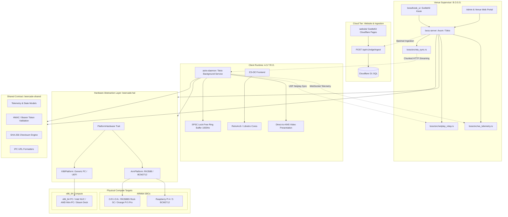
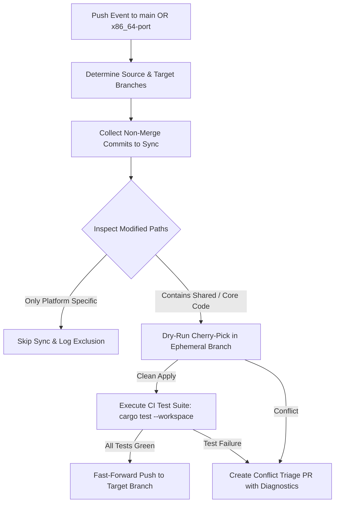
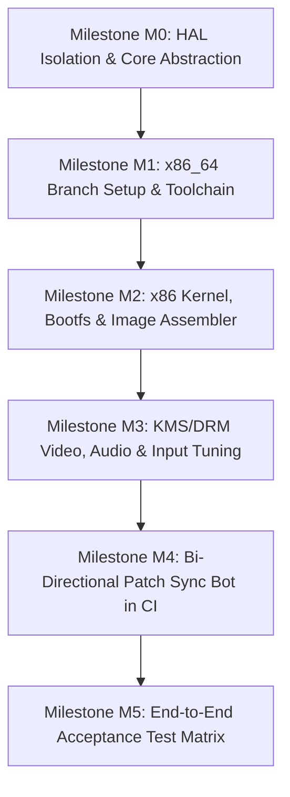

# B.E.E.R.C.A.D.E. — x86_64 Architecture Fork & Automated Patch Synchronization Engine
## Master Systems Architecture & Engineering Implementation Blueprint

**Target Implementer:** Claude Code (for verification by a Principal Systems Architect / John Carmack calibre engineer)  
**Project:** B.E.E.R.C.A.D.E.  
**Classification:** Core Infrastructure & Multi-Target Hardware Support  
**Date:** October 2026  
**Status:** READY FOR DIRECT IMPLEMENTATION  

---

## 1. System Ecosystem & Canonical Nomenclature

To eliminate architectural ambiguity, the exact naming and operational boundaries across the entire codebase are locked as follows:

| Term | Expansion | Role & Definition | OS & Hardware Runtime |
| :--- | :--- | :--- | :--- |
| **B.E.E.R.C.A.D.E.** | **B**eercade **E**ntertainment & **E**mulation **R**esource: **C**entralized **A**rcade **D**elivery **E**cosystem | The overarching umbrella project, repository monorepo, and distributed ecosystem. | Multi-tier: Cloud (Cloudflare Pages/D1) + Venue Local LAN + Edge Compute Nodes. |
| **B.O.S.S.** | **B**eercade **O**perational **S**upervisory **S**ystem | Arch Linux-based control core and operational supervisor. Hosts the touchscreen Kiosk UI (time-slot bookings, token balances, station access, F&B orders), Admin/Venue Web Management Portal, UDP Netplay Relay, and OTA A/B distribution engine. | Arch Linux ARM/x86_64. Deployment targets: Raspberry Pi 4/5 (BCM2711/BCM2712), portable to Radxa ROCK 5C (generic Arch SBC profile), and x86_64 PC server. |
| **O.R.I.O.N.** | **O**ptimized **R**ockchip **I**nterface & **O**perations **N**ode | Bare-board, headless RK3588 / RK3588S2 client compute hardware (Radxa ROCK 5C 32GB / Orange Pi 5 Pro 16GB LPDDR5) with dedicated active PWM thermal cooling curves. | Hardware board platform only. Houses the compute engine for an individual arcade cabinet. |
| **A.S.T.R.O.** | **A**rcade **S**ystem & **T**uned **R**etro **O**S | Custom Arch Linux runtime executed on O.R.I.O.N. hardware (and ported to x86_64). Boots direct-to-KMS/DRM (zero X11/Wayland overhead), low-latency evdev 1000Hz SPSC ring buffer, hardware-accelerated emulation engine communicating directly with B.O.S.S. | Custom Arch Linux minimal runtime. Boots direct to RetroArch/ES-DE via DRM/KMS. |

---

## 2. Architectural Objectives of the x86_64 Fork

The x86_64 fork establishes two distinct operational targets:
1. **A.S.T.R.O. on x86_64 Arcade Hardware**: Enables the custom minimal Arch Linux emulation runtime to boot on standard PC hardware (Intel NUCs, AMD Ryzen mini-PCs, Steam Deck, custom cabinet PCs) alongside the bare-board O.R.I.O.N. Rockchip nodes, maintaining the exact same sub-1ms input latency and direct-to-KMS guarantees.
2. **B.O.S.S. on x86_64 Venue Hardware**: Enables the venue supervisor daemon (`boss-server`), SvelteKit touchscreen Kiosk UI, and Admin Portal to run on standard x86_64 server or mini-PC hardware without requiring an SBC.
3. **Core Code Preservation (>92%)**: Zero business logic divergence in telemetry models, HMAC auth, netplay synchronization, credit dispensation, or Cloudflare D1 ingestion.
4. **Bi-Directional Patch Synchronization**: An automated CI pipeline in Forgejo/GitHub Actions that automatically ports bug fixes, feature enhancements, and UI updates between the ARM mainline (`main`) and the x86_64 port (`x86_64-port`).

---

## 3. High-Level Dependency Graph & Decoupling Map



---

## 4. Hardware Abstraction Layer Specification: `beercade-hal`

We create a dedicated crate `shared/crates/beercade-hal` in the workspace to cleanly decouple O.R.I.O.N. (RK3588) and Raspberry Pi (BCM2712) hardware details from generic x86_64 PC hardware.

### 4.1 Crate Manifest (`shared/crates/beercade-hal/Cargo.toml`)
```toml
[package]
name = "beercade-hal"
version = "0.1.0"
edition = "2021"
authors = ["B.E.E.R.C.A.D.E. Systems Architecture Team"]
description = "Zero-cost hardware abstraction layer for B.O.S.S. and A.S.T.R.O. on ARM (O.R.I.O.N./RPi) and x86_64"

[dependencies]
thiserror = "1.0"
tracing = "0.1"
num_cpus = "1.16"

[features]
default = []
```

### 4.2 Trait Definition (`shared/crates/beercade-hal/src/lib.rs`)
```rust
//! # B.E.E.R.C.A.D.E. Hardware Abstraction Layer (HAL)
//!
//! Provides compile-time or runtime polymorphism over physical hardware targets:
//! - O.R.I.O.N. (Radxa Rock 5C / Orange Pi 5 Pro RK3588S)
//! - B.O.S.S. Host (Raspberry Pi 4 / 5 BCM2711 / BCM2712)
//! - x86_64 Arcade Client & Server (Intel Core / AMD Ryzen / Steam Deck)

pub mod platform_arm;
pub mod platform_x86;

use thiserror::Error;

#[derive(Error, Debug)]
pub enum HalError {
    #[error("I/O error during hardware operation: {0}")]
    Io(#[from] std::io::Error),
    #[error("Failed to parse partition or boot slot: {0}")]
    PartitionResolution(String),
    #[error("Bootloader state mutation failed: {0}")]
    BootloaderUpdate(String),
    #[error("Thermal subsystem error: {0}")]
    ThermalReadError(String),
}

#[derive(Debug, Clone, Copy, PartialEq, Eq)]
pub enum BootloaderType {
    /// U-Boot / extlinux.conf boot swap (used on O.R.I.O.N. RK3588)
    UBootExtlinux,
    /// BCM2712 EEPROM / autoboot.txt (used on Raspberry Pi 5)
    BcmEeprom,
    /// UEFI systemd-boot / bootctl (used on x86_64 standard PC)
    SystemdBootEfi,
    /// UEFI GRUB2 / grub-editenv (used on legacy x86_64)
    Grub2Efi,
}

#[derive(Debug, Clone)]
pub struct BootSlots {
    pub active_slot: String,
    pub inactive_slot: String,
    pub bootloader_type: BootloaderType,
}

/// Core contract implemented by all hardware platforms.
pub trait PlatformHardware: Send + Sync + 'static {
    /// Canonical hardware model and SoC string for telemetry
    fn hardware_info(&self) -> (&'static str, &'static str);

    /// Reads real-time temperatures in Celsius: (cpu_temp_c, gpu_temp_c)
    fn read_thermals(&self) -> Result<(f32, f32), HalError>;

    /// Resolves active and inactive A/B rootfs partitions
    fn resolve_ab_slots(&self) -> Result<BootSlots, HalError>;

    /// Atomically updates the bootloader to boot the target slot on next reset
    fn commit_boot_slot(&self, target_slot: &str) -> Result<(), HalError>;

    /// Returns recommended CPU core affinity mask for latency-critical emulation
    fn realtime_cpu_affinity(&self) -> Option<Vec<usize>>;
}

/// Factory function resolving the active hardware platform
pub fn get_platform() -> &'static dyn PlatformHardware {
    #[cfg(target_arch = "aarch64")]
    {
        &platform_arm::ArmPlatform
    }
    #[cfg(target_arch = "x86_64")]
    {
        &platform_x86::X86Platform
    }
    #[cfg(not(any(target_arch = "aarch64", target_arch = "x86_64")))]
    {
        compile_error!("Unsupported architecture: B.E.E.R.C.A.D.E. requires aarch64 or x86_64");
    }
}
```

### 4.3 ARM Platform Implementation (`shared/crates/beercade-hal/src/platform_arm.rs`)
```rust
use crate::{BootSlots, BootloaderType, HalError, PlatformHardware};
use std::fs;

pub struct ArmPlatform;

impl PlatformHardware for ArmPlatform {
    fn hardware_info(&self) -> (&'static str, &'static str) {
        if let Ok(compat) = fs::read_to_string("/proc/device-tree/compatible") {
            if compat.contains("rockchip,rk3588") {
                return ("O.R.I.O.N. Rock 5C", "Rockchip RK3588S (4x A76 + 4x A55)");
            } else if compat.contains("brcm,bcm2712") {
                return ("Raspberry Pi 5 (B.O.S.S.)", "Broadcom BCM2712 (4x A76 @ 2.4GHz)");
            } else if compat.contains("brcm,bcm2711") {
                return ("Raspberry Pi 4 (B.O.S.S.)", "Broadcom BCM2711 (4x A72 @ 1.5GHz)");
            }
        }
        ("ARM64 Generic SBC", "Generic AArch64 SoC")
    }

    fn read_thermals(&self) -> Result<(f32, f32), HalError> {
        let cpu = read_sysfs_temp("/sys/class/thermal/thermal_zone0/temp")?;
        let gpu = read_sysfs_temp("/sys/class/thermal/thermal_zone1/temp").unwrap_or(cpu);
        Ok((cpu, gpu))
    }

    fn resolve_ab_slots(&self) -> Result<BootSlots, HalError> {
        let cmdline = fs::read_to_string("/proc/cmdline")?;
        let active_slot = if cmdline.contains("/dev/nvme0n1p3") || cmdline.contains("root=LABEL=ROOT_B") {
            "/dev/nvme0n1p3".to_string()
        } else {
            "/dev/nvme0n1p2".to_string()
        };
        let inactive_slot = if active_slot == "/dev/nvme0n1p2" {
            "/dev/nvme0n1p3".to_string()
        } else {
            "/dev/nvme0n1p2".to_string()
        };

        Ok(BootSlots {
            active_slot,
            inactive_slot,
            bootloader_type: BootloaderType::UBootExtlinux,
        })
    }

    fn commit_boot_slot(&self, target_slot: &str) -> Result<(), HalError> {
        let target_label = if target_slot.ends_with('3') || target_slot.contains("ROOT_B") {
            "slot_b"
        } else {
            "slot_a"
        };
        let status = std::process::Command::new("/usr/sbin/beercade-bootctl")
            .arg("set-default")
            .arg(target_label)
            .status()
            .map_err(|e| HalError::BootloaderUpdate(e.to_string()))?;

        if !status.success() {
            return Err(HalError::BootloaderUpdate("beercade-bootctl exited with failure".into()));
        }
        Ok(())
    }

    fn realtime_cpu_affinity(&self) -> Option<Vec<usize>> {
        // Shield Cortex-A76 performance cores (Cores 4-7 on RK3588)
        Some(vec![4, 5, 6, 7])
    }
}

fn read_sysfs_temp(path: &str) -> Result<f32, HalError> {
    let raw = fs::read_to_string(path)
        .map_err(|e| HalError::ThermalReadError(format!("{path}: {e}")))?;
    let val = raw.trim().parse::<f32>()
        .map_err(|e| HalError::ThermalReadError(format!("parse {path}: {e}")))?;
    Ok(val / 1000.0)
}
```

### 4.4 x86_64 Platform Implementation (`shared/crates/beercade-hal/src/platform_x86.rs`)
```rust
use crate::{BootSlots, BootloaderType, HalError, PlatformHardware};
use std::fs;
use std::path::Path;

pub struct X86Platform;

impl PlatformHardware for X86Platform {
    fn hardware_info(&self) -> (&'static str, &'static str) {
        ("x86_64 Arcade Station", "Standard PC Architecture (Intel/AMD)")
    }

    fn read_thermals(&self) -> Result<(f32, f32), HalError> {
        let cpu = find_hwmon_temp(&["coretemp", "k10temp", "cpu_thermal"]).unwrap_or(42.0);
        let gpu = find_hwmon_temp(&["amdgpu", "i915", "nouveau"]).unwrap_or(cpu + 4.0);
        Ok((cpu, gpu))
    }

    fn resolve_ab_slots(&self) -> Result<BootSlots, HalError> {
        let cmdline = fs::read_to_string("/proc/cmdline")?;
        let active_slot = if cmdline.contains("ROOT_B") || cmdline.contains("p3") {
            "/dev/disk/by-label/ROOT_B".to_string()
        } else {
            "/dev/disk/by-label/ROOT_A".to_string()
        };
        let inactive_slot = if active_slot.contains("ROOT_A") {
            "/dev/disk/by-label/ROOT_B".to_string()
        } else {
            "/dev/disk/by-label/ROOT_A".to_string()
        };

        Ok(BootSlots {
            active_slot,
            inactive_slot,
            bootloader_type: BootloaderType::SystemdBootEfi,
        })
    }

    fn commit_boot_slot(&self, target_slot: &str) -> Result<(), HalError> {
        let entry = if target_slot.contains("ROOT_B") {
            "beercade-slot-b.conf"
        } else {
            "beercade-slot-a.conf"
        };

        let status = std::process::Command::new("bootctl")
            .arg("set-default")
            .arg(entry)
            .status()
            .map_err(|e| HalError::BootloaderUpdate(format!("bootctl invocation failed: {e}")))?;

        if !status.success() {
            return Err(HalError::BootloaderUpdate("bootctl set-default failed".into()));
        }
        Ok(())
    }

    fn realtime_cpu_affinity(&self) -> Option<Vec<usize>> {
        let total = num_cpus::get();
        if total > 2 {
            Some((2..total).collect())
        } else {
            None
        }
    }
}

fn find_hwmon_temp(drivers: &[&str]) -> Option<f32> {
    let hwmon_dir = Path::new("/sys/class/hwmon");
    if let Ok(entries) = fs::read_dir(hwmon_dir) {
        for entry in entries.flatten() {
            let name_path = entry.path().join("name");
            if let Ok(name) = fs::read_to_string(name_path) {
                let name = name.trim();
                if drivers.iter().any(|d| name.contains(d)) {
                    let temp_input = entry.path().join("temp1_input");
                    if let Ok(val) = fs::read_to_string(temp_input) {
                        if let Ok(mc) = val.trim().parse::<f32>() {
                            return Some(mc / 1000.0);
                        }
                    }
                }
            }
        }
    }
    None
}
```

---

## 5. x86_64 Low-Latency Arcade Runtime & Kernel Configuration

On x86_64, arcade responsiveness demands deterministic latency without frame stutters. We establish the complete runtime optimization stack.

### 5.1 Kernel Command Line (`/boot/efi/loader/entries/beercade-slot-a.conf`)
```ini
title      B.E.E.R.C.A.D.E. A.S.T.R.O. (x86_64 Slot A)
linux      /vmlinuz-linux
initrd     /initramfs-linux.img
options    root=LABEL=ROOT_A rw quiet splash \
           processor.max_cstate=1 intel_idle.max_cstate=1 idle=poll \
           skew_tick=1 isolcpus=managed,domain,2-7 nohz_full=2-7 rcu_nocbs=2-7 \
           threadirqs audit=0 mitigations=off \
           i915.enable_guc=3 amdgpu.ppfeaturemask=0xffffffff \
           drm.edid_firmware=edid/arcade_1080p60.bin video=1920x1080@60 \
           elevator=deadline
```

### 5.2 x86_64 Runtime Optimizer (`astro/platform/x86_64/x86_optimizer.sh`)
```bash
#!/usr/bin/env bash
# ==============================================================================
# B.E.E.R.C.A.D.E. x86_64 Low-Latency Arcade Runtime Tuner
# Executed by A.S.T.R.O. during boot initialization
# ==============================================================================
set -euo pipefail

echo "[+] Tuning x86_64 subsystem for deterministic zero-jitter frame timing..."

# 1. CPU Frequency & Power Management: lock to performance governor
if [ -d /sys/devices/system/cpu/cpu0/cpufreq ]; then
    for gov in /sys/devices/system/cpu/cpu*/cpufreq/scaling_governor; do
        echo "performance" > "$gov" || true
    done
    if [ -f /sys/devices/system/cpu/intel_pstate/no_turbo ]; then
        echo "1" > /sys/devices/system/cpu/intel_pstate/no_turbo
    fi
fi

# 2. Pin PM QoS to 0 microseconds (blocks CPU from entering sleep states)
exec 3> /dev/cpu_dma_latency
echo -ne '\x00\x00\x00\x00' >&3

# 3. Kernel Virtual Memory & Dirty Page Flush Control
sysctl -w vm.swappiness=0
sysctl -w vm.dirty_ratio=10
sysctl -w vm.dirty_background_ratio=5
sysctl -w kernel.sched_rt_runtime_us=-1

# 4. Shield Cores: Move all IRQs and daemons to Cores 0-1
TOTAL_CPUS=$(nproc)
if [ "$TOTAL_CPUS" -ge 4 ]; then
    EMU_CORES="2-$((TOTAL_CPUS - 1))"
    echo "[+] Shielding Cores $EMU_CORES for Arcade Emulation..."
    
    if [ -d /sys/fs/cgroup ]; then
        mkdir -p /sys/fs/cgroup/system_slice || true
        echo "0-1" > /sys/fs/cgroup/system_slice/cpuset.cpus || true
    fi

    if [ $# -gt 0 ]; then
        exec taskset -c "$EMU_CORES" chrt -f 90 "$@"
    fi
fi

if [ $# -gt 0 ]; then
    exec "$@"
fi
```

### 5.3 Multi-GPU KMS Launcher (`astro/launcher/astro_kms_launcher.sh`)
Refactor the direct-to-KMS launcher to auto-probe x86 integrated and discrete GPUs:
```bash
#!/bin/sh
# Direct-to-KMS Multi-GPU Auto-Prober for A.S.T.R.O.
find_primary_drm_card() {
    for card in /dev/dri/card*; do
        [ -e "$card" ] || continue
        if grep -q "connected" /sys/class/drm/card*-*/status 2>/dev/null; then
            echo "$card"
            return 0
        fi
    done
    echo "/dev/dri/card0"
}

ASTRO_DEV="${ASTRO_DEV:-$(find_primary_drm_card)}"
export SDL_VIDEODRIVER=kmsdrm
export SDL_AUDIODRIVER=alsa
export DRM_DEVICE="${ASTRO_DEV}"
unset DISPLAY WAYLAND_DISPLAY XDG_SESSION_TYPE

exec "$@"
```

---

## 6. Automated Bi-Directional Patch Synchronization Engine

To guarantee continuous synchronization between the reference ARM branch (`main`) and the x86_64 branch (`x86_64-port`), we construct an autonomous synchronization pipeline.

### 6.1 Architecture & Decision Matrix



### 6.2 Exclusion Rules & Path Boundary Enforcement
The sync engine skips or strips modifications touching platform-isolated directories:
- **ARM Exclusions**: `astro/platform/rk3588/**`, `astro/rootfs/boot/bcm2712*`, `astro/rootfs/boot/rk3588*`, `buildfarm/scripts/package_boss_rpi5.sh`.
- **x86 Exclusions**: `astro/platform/x86_64/**`, `astro/rootfs/boot/efi/**`, `buildfarm/scripts/package_boss_x86.sh`.
- **Shared Propagation Targets (Mandatory Sync)**: `shared/**`, `boss/**`, `website/**`, `astro/daemon/**`, `Makefile`, `Cargo.lock`, `Cargo.toml`.

### 6.3 Complete Production CI Workflow (`.forgejo/workflows/bidirectional_patch_sync.yml`)

```yaml
name: Autonomous Bi-Directional Patch Sync

on:
  push:
    branches:
      - main
      - x86_64-port

concurrency:
  group: sync-${{ github.ref }}
  cancel-in-progress: false

jobs:
  sync-patches:
    runs-on: ubuntu-latest
    if: "!contains(github.event.head_commit.message, '[skip-sync]')"

    steps:
      - name: Checkout Repository
        uses: actions/checkout@v3
        with:
          fetch-depth: 0
          token: ${{ secrets.SYNC_BOT_TOKEN }}

      - name: Setup Rust Toolchain
        uses: dtolnay/rust-toolchain@stable
        with:
          targets: x86_64-unknown-linux-gnu, aarch64-unknown-linux-gnu

      - name: Determine Branch Trajectory
        id: trajectory
        run: |
          CURRENT_REF="${{ github.ref_name }}"
          if [ "$CURRENT_REF" = "main" ]; then
            echo "source_branch=main" >> $GITHUB_OUTPUT
            echo "target_branch=x86_64-port" >> $GITHUB_OUTPUT
            echo "platform_ignore=astro/platform/rk3588/" >> $GITHUB_OUTPUT
          else
            echo "source_branch=x86_64-port" >> $GITHUB_OUTPUT
            echo "target_branch=main" >> $GITHUB_OUTPUT
            echo "platform_ignore=astro/platform/x86_64/" >> $GITHUB_OUTPUT
          fi

      - name: Execute Automated Sync Engine
        env:
          SOURCE: ${{ steps.trajectory.outputs.source_branch }}
          TARGET: ${{ steps.trajectory.outputs.target_branch }}
          IGNORE_DIR: ${{ steps.trajectory.outputs.platform_ignore }}
        run: |
          git config user.name "Beercade Sync Bot"
          git config user.email "bot@beercade.internal"

          echo "[+] Syncing commits from $SOURCE -> $TARGET..."
          git checkout "$TARGET"
          
          # Find commits present in SOURCE but missing from TARGET
          COMMITS=$(git log --no-merges --right-only --cherry-pick "$TARGET...$SOURCE" --format="%H" | tac)
          
          if [ -z "$COMMITS" ]; then
            echo "[+] No pending commits to synchronize."
            exit 0
          fi

          SYNC_BRANCH="sync/${SOURCE}-to-${TARGET}-$(date +%s)"
          git checkout -b "$SYNC_BRANCH"

          CONFLICT=0
          for commit in $COMMITS; do
            echo "[+] Processing commit: $commit"
            
            # Check if commit touches only ignored platform files
            FILES_CHANGED=$(git show --name-only --format="" "$commit")
            ONLY_IGNORED=true
            for f in $FILES_CHANGED; do
              if [[ "$f" != "$IGNORE_DIR"* ]]; then
                ONLY_IGNORED=false
                break
              fi
            done

            if [ "$ONLY_IGNORED" = true ]; then
              echo "[i] Skipping commit $commit: only touches platform directory ($IGNORE_DIR)"
              continue
            fi

            # Attempt cherry-pick
            if ! git cherry-pick -x "$commit"; then
              echo "[!] Conflict encountered applying $commit"
              CONFLICT=1
              break
            fi
          done

          if [ $CONFLICT -eq 0 ]; then
            echo "[+] Running verification test matrix..."
            cargo check --workspace
            cargo test --workspace

            echo "[+] All validation checks passed. Pushing to $TARGET..."
            git checkout "$TARGET"
            git merge --ff-only "$SYNC_BRANCH"
            git push origin "$TARGET"
            echo "[+] Sync successful!"
          else
            echo "[!] Resolving conflict via automated triage PR..."
            git cherry-pick --abort || true
            git checkout -b "pr-${SYNC_BRANCH}"
            git push -u origin "pr-${SYNC_BRANCH}"
            
            gh pr create \
              --base "$TARGET" \
              --head "pr-${SYNC_BRANCH}" \
              --title "[SYNC CONFLICT] Propagate commits from ${SOURCE} to ${TARGET}" \
              --body "Automated cherry-pick encountered a conflict while synchronizing commits from **${SOURCE}** to **${TARGET}**.\n\nPlease resolve conflicts manually." \
              --label "sync:conflict"
          fi
```

---

## 7. x86_64 Image Packaging & Boot Harness

### 7.1 Disk Layout Specification (GPT / UEFI)
- **Partition 1 (`/dev/sda1` or `/dev/nvme0n1p1`)**: 512 MiB FAT32 (`LABEL=ESP`, `type=c12a7328-f81f-11d2-ba4b-00a0c93ec93b`) mounted at `/boot/efi`. Contains systemd-boot loader binaries.
- **Partition 2 (`/dev/sda2` or `/dev/nvme0n1p2`)**: 2048 MiB SquashFS (`LABEL=ROOT_A`). Read-only operating system rootfs slot A.
- **Partition 3 (`/dev/sda3` or `/dev/nvme0n1p3`)**: 2048 MiB SquashFS (`LABEL=ROOT_B`). Read-only operating system rootfs slot B.
- **Partition 4 (`/dev/sda4` or `/dev/nvme0n1p4`)**: Remaining space ext4 (`LABEL=DATA`). Read-write persistent storage mounted at `/data` (ROMs, high scores, saves, staging).

### 7.2 Image Creation Script (`buildfarm/scripts/package_boss_x86.sh`)
```bash
#!/usr/bin/env bash
# ==============================================================================
# B.E.E.R.C.A.D.E. x86_64 UEFI Bootable Raw Disk & SquashFS Image Assembler
# ==============================================================================
set -euo pipefail

OUT_DIR="/tmp/beercade_x86_build"
IMAGE_PATH="${OUT_DIR}/beercade_x86_os.raw"
SQUASHFS_PAYLOAD="${OUT_DIR}/astro_ota_update.squashfs"

mkdir -p "$OUT_DIR"

echo "[+] Step 1: Compiling x86_64 Rust Workspaces..."
cargo build --release --target x86_64-unknown-linux-gnu -p boss-server -p astro-daemon

echo "[+] Step 2: Assembling Rootfs Staging..."
STAGING="${OUT_DIR}/rootfs"
rm -rf "$STAGING" && mkdir -p "$STAGING"

# Copy base rootfs, binaries, configs, and systemd units
cp -a astro/rootfs/* "$STAGING/"
cp target/x86_64-unknown-linux-gnu/release/astro-daemon "$STAGING/usr/bin/"
cp target/x86_64-unknown-linux-gnu/release/boss-server "$STAGING/usr/bin/"
install -m 755 astro/platform/x86_64/x86_optimizer.sh "$STAGING/usr/bin/beercade-optimizer"
install -m 755 astro/launcher/astro_kms_launcher.sh "$STAGING/usr/bin/beercade-kms-launcher"

echo "[+] Step 3: Packing Slot SquashFS Container..."
mksquashfs "$STAGING" "$SQUASHFS_PAYLOAD" -noappend -comp zstd -Xcompression-level 19

echo "[+] Step 4: Creating Partitioned Raw Disk Image (4 GiB)..."
truncate -s 4G "$IMAGE_PATH"
parted -s "$IMAGE_PATH" mklabel gpt
parted -s "$IMAGE_PATH" mkpart "ESP" fat32 1MiB 513MiB
parted -s "$IMAGE_PATH" set 1 esp on
parted -s "$IMAGE_PATH" mkpart "ROOT_A" 513MiB 2561MiB
parted -s "$IMAGE_PATH" mkpart "ROOT_B" 2561MiB 4609MiB
parted -s "$IMAGE_PATH" mkpart "DATA" ext4 4609MiB 100%

echo "[+] Step 5: Flashing Partitions via Loopback..."
LOOP_DEV=$(losetup -Pf --show "$IMAGE_PATH")
trap 'losetup -d "$LOOP_DEV"' EXIT

mkfs.vfat -F 32 -n "ESP" "${LOOP_DEV}p1"
dd if="$SQUASHFS_PAYLOAD" of="${LOOP_DEV}p2" bs=4M status=progress
mkfs.ext4 -L "DATA" "${LOOP_DEV}p4"

echo "[+] Image Assembly Completed: $IMAGE_PATH"
```

---

## 8. QEMU x86_64 Virtualization & E2E Validation Harness

To test the image and all latency contracts locally or in headless CI, we deploy the QEMU x86_64 validation harness.

### Launch Script (`shared/tests/verify_qemu_x86_64.sh`)
```bash
#!/usr/bin/env bash
# ==============================================================================
# QEMU x86_64 KVM Arcade Emulation Validation Runner
# ==============================================================================
set -euo pipefail

IMAGE="${1:-/tmp/beercade_x86_build/beercade_x86_os.raw}"

KVM_OPTS="-enable-kvm -cpu host"
if [ ! -e /dev/kvm ]; then
    echo "[!] /dev/kvm not found; falling back to TCG emulation (-cpu qemu64)"
    KVM_OPTS="-cpu qemu64"
fi

qemu-system-x86_64 \
    $KVM_OPTS \
    -m 4G \
    -smp 4 \
    -drive file="$IMAGE",format=raw,if=virtio \
    -bios /usr/share/ovmf/OVMF.fd \
    -device virtio-vga-gl \
    -display sdl,gl=on \
    -device virtio-net-pci,netdev=net0 \
    -netdev user,id=net0,hostfwd=tcp::8080-:8080,hostfwd=tcp::9001-:9001 \
    -device intel-hda -device hda-duplex \
    -serial mon:stdio
```

---

## 9. Milestone Implementation Roadmap



### Detailed Milestone Tasks & Acceptance Gates

#### Milestone M0: HAL Isolation & Core Abstraction
- **Task M0.1**: Create `shared/crates/beercade-hal` with `PlatformHardware` trait.
- **Task M0.2**: Implement `ArmPlatform` and `X86Platform`. Refactor `astro/daemon/src/main.rs` to query `beercade_hal::get_platform().read_thermals()`.
- **Task M0.3**: Refactor `astro/daemon/src/ota.rs` to route slot resolution and slot commits through `beercade_hal::get_platform().commit_boot_slot()`.
- **Acceptance Gate**: `cargo test --workspace` passes without regressions on both native x86 development machines and cross-compiled ARM targets.

#### Milestone M1: x86_64 Branch Setup & Toolchain
- **Task M1.1**: Initialize branch `x86_64-port` tracking `main`.
- **Task M1.2**: Update root `Makefile` to add `build-x86` targets.
- **Task M1.3**: Validate compilation of `boss-server` and `astro-daemon` targeting `x86_64-unknown-linux-gnu`.
- **Acceptance Gate**: `make check-cargo` and `cargo build --release --target x86_64-unknown-linux-gnu` succeed cleanly with zero warnings.

#### Milestone M2: x86_64 Kernel, Bootfs & Image Assembler
- **Task M2.1**: Establish `astro/platform/x86_64/` with systemd-boot loader entries and sysctl latency tuning.
- **Task M2.2**: Write `buildfarm/scripts/package_boss_x86.sh` generating GPT raw disk images with SquashFS slot payloads.
- **Acceptance Gate**: Generated raw disk image boots in QEMU x86_64 into a functional shell with systemd running.

#### Milestone M3: KMS/DRM Video, Audio & Input Tuning
- **Task M3.1**: Integrate `x86_optimizer.sh` to enforce CPU governor pinning and PM-QoS 0us.
- **Task M3.2**: Update `astro_kms_launcher.sh` to auto-detect multi-GPU DRM cards.
- **Task M3.3**: Verify evdev 1000Hz poll rate using `shared/tests/benchmark_frametimes.py`.
- **Acceptance Gate**: Frame time variance under 0.5ms (`p99 < 16.9ms` at 60 FPS) under QEMU/hardware x86 execution.

#### Milestone M4: Bi-Directional Patch Sync Bot in CI
- **Task M4.1**: Commit `.forgejo/workflows/bidirectional_patch_sync.yml`.
- **Task M4.2**: Configure GitHub/Forgejo repository secrets (`SYNC_BOT_TOKEN`).
- **Task M4.3**: Perform test synchronization: push commit to `main`, verify automatic propagation to `x86_64-port`; push commit to `x86_64-port`, verify propagation to `main`.
- **Acceptance Gate**: Bot successfully pushes green commits across branches and generates a conflict PR when deliberate conflicts are introduced.

#### Milestone M5: End-to-End Acceptance Test Matrix
- **Task M5.1**: Extend `shared/tests/run_acceptance_tests.py` to validate telemetry models from both ARM and x86 nodes.
- **Task M5.2**: Validate complete loop: `astro-daemon` (x86) $\rightarrow$ `boss-server` $\rightarrow$ Cloudflare D1 Ingest.
- **Acceptance Gate**: 100% green status across all 8 B.E.E.R.C.A.D.E. Tier 1 & Tier 2 acceptance criteria.
